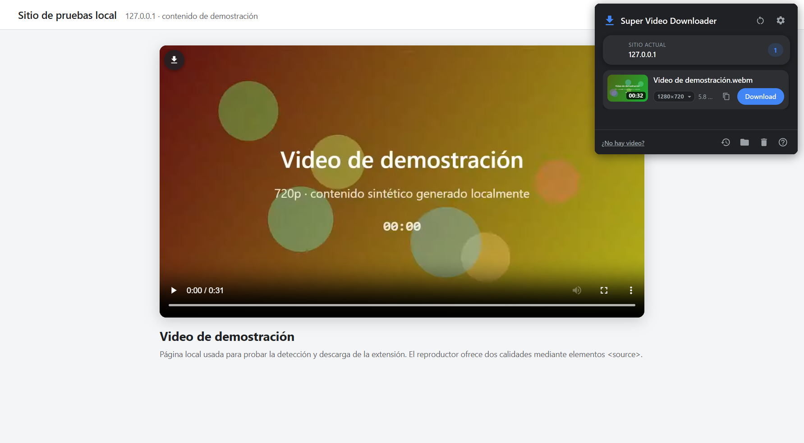
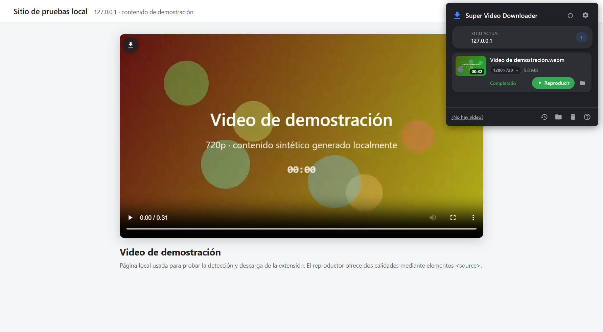
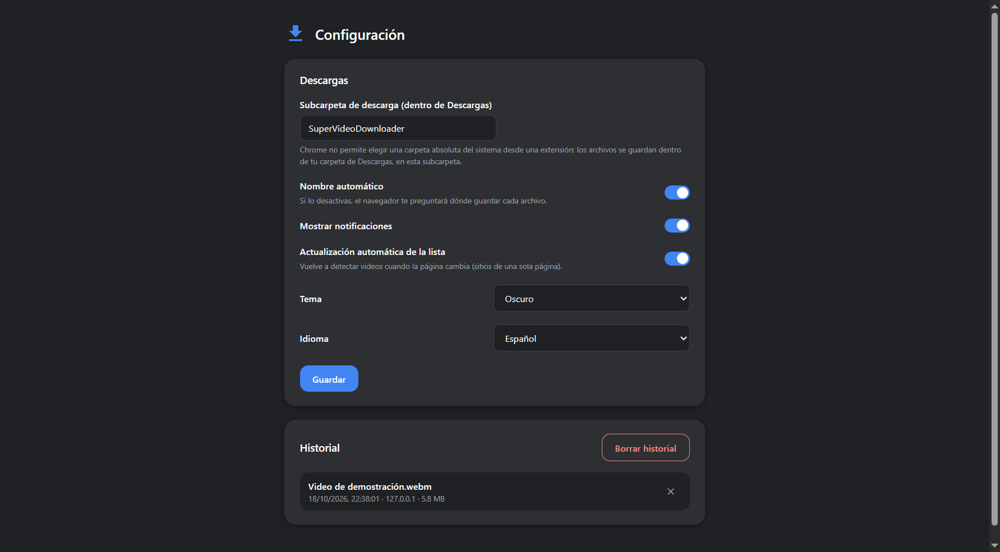

<p align="center">
  
</p>

<h1 align="center">Super Video Downloader — Sitio web</h1>

<p align="center">
  Sitio web oficial de <b>Super Video Downloader</b>, la extensión de Chrome que detecta los videos de la página, incluidos los streams HLS, y los descarga con un clic.
</p>

<p align="center">
  <a href="https://alvarosiles.github.io/webstore-super-video-downloader/"><b>Ver el sitio</b></a> ·
  <a href="https://alvarosiles.github.io/webstore-super-video-downloader/privacy.html">Política de privacidad</a> ·
  <a href="https://github.com/alvarosiles/super-video-downloader">Código de la extensión</a>
</p>

---

## Sobre la extensión

Super Video Downloader es una extensión para Google Chrome y navegadores
Chromium (Manifest V3, versión 109 o superior). Detecta los videos de enlace
directo y los streams HLS sin cifrar de la página actual, y los descarga
localmente. Los streams HLS se reconstruyen en un único `.mp4` con
`ffmpeg.wasm`, dentro del propio navegador.

- **Detección automática** de videos en el DOM y en la red
- **Streams HLS** reconstruidos en `.mp4`, con progreso y cancelación
- **Selector de calidad**, tamaño y copia de URL
- **Botón de descarga** sobre cada video y opción en el menú contextual
- **Historial**, subcarpeta de descarga, tema e idioma configurables
- **No elude DRM**: el contenido protegido se detecta pero no se descarga

<p align="center">
  
  
  
</p>

## Contenido del repositorio

```
├── index.html                 # Página principal
├── privacy.html               # Política de privacidad
├── assets/
│   ├── icon32.png · icon128.png
│   ├── promo-marquee.png      # Imagen promocional
│   └── capturas/              # Capturas de la extensión en funcionamiento
├── extension/
│   └── super-video-downloader-v1.0.0.zip   # Paquete de la extensión (≈9.8 MB)
├── LICENSE
└── README.md
```

Es un sitio estático: no tiene proceso de build, dependencias, cookies ni
herramientas de analítica.

## Instalar la extensión

1. Descarga `super-video-downloader-v1.0.0.zip` desde el sitio y descomprímelo.
2. Abre `chrome://extensions` y activa el **Modo de desarrollador**.
3. Pulsa **Cargar descomprimida** y selecciona la carpeta `super-video-downloader/`.

## Uso responsable

La extensión está pensada para guardar contenido que tienes derecho a
descargar. Respeta los derechos de autor y los términos de servicio de cada
sitio.

## Derechos

© 2026 Alvaro Siles Estrada. **Todos los derechos reservados.**

El contenido de este sitio (código, diseño, textos e imágenes) no puede
copiarse ni reutilizarse sin autorización. El paquete de la extensión de
`extension/` se distribuye bajo licencia MIT e incluye componentes de terceros
con sus propias licencias. Ver [LICENSE](LICENSE).

## Contacto

alvarosiles.developer@gmail.com · [github.com/alvarosiles](https://github.com/alvarosiles)
